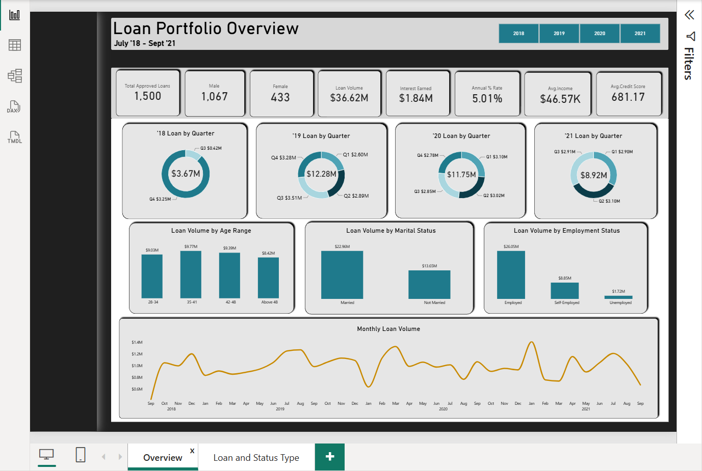
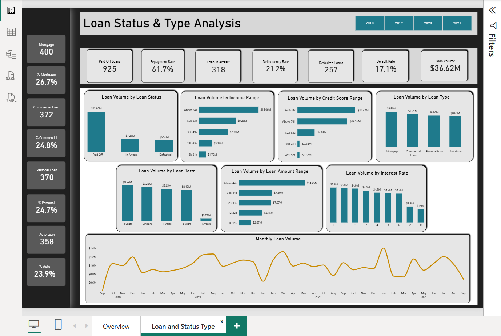
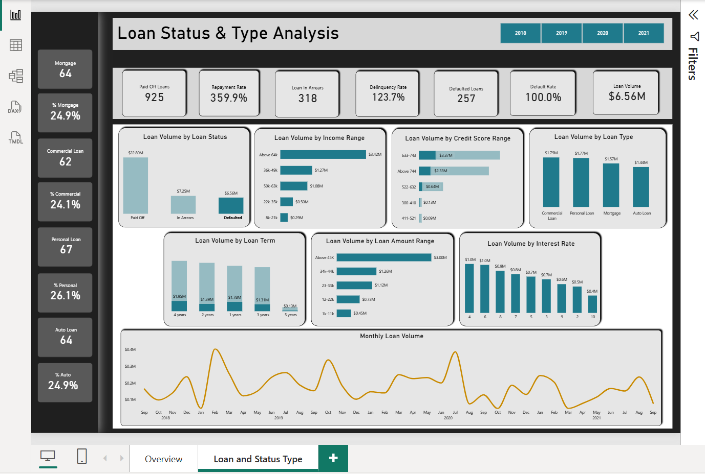
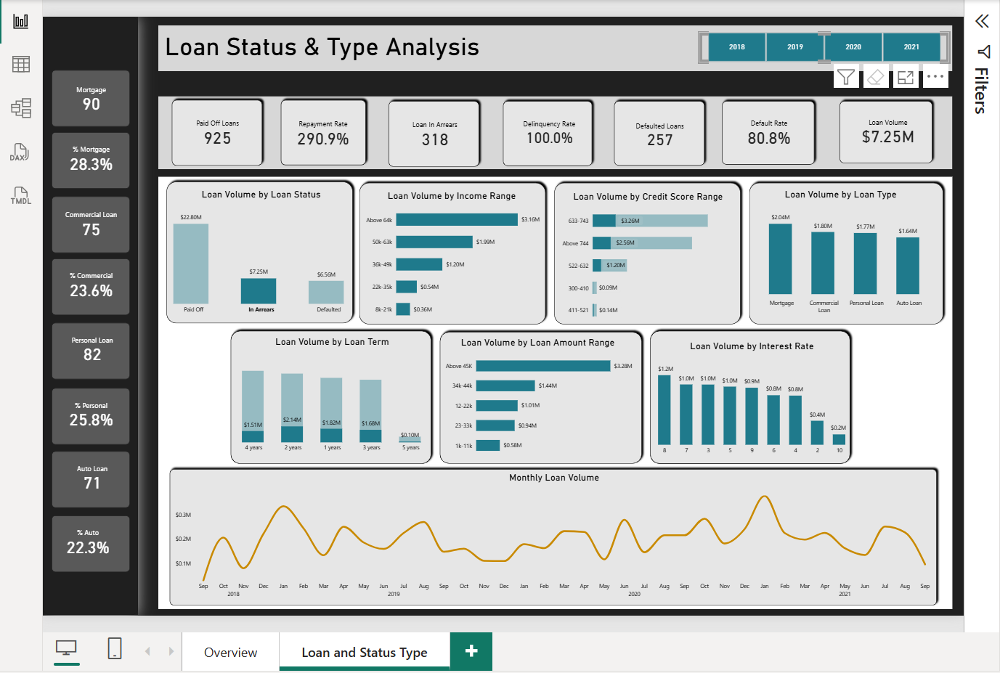
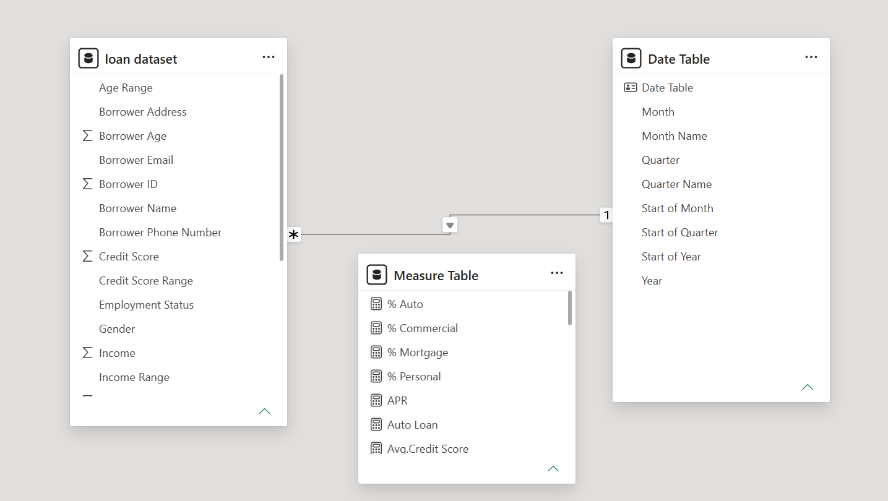

# Bank Loan Default Analysis

A Power BI analysis of a 1,500 loan bank portfolio covering September 2018 to September 2021. The project investigates which borrowers default, whether the bank's own data can predict default, and where the losses are actually concentrated.

---

## Business Problem

A retail and commercial bank holds a large and varied loan portfolio. Its existing approach to assessing risk was built for a slower market and is no longer keeping up. The bank is exposed to credit losses, regulatory pressure and reputational damage, and it cannot tell in advance which loans are likely to go bad.

The bank wanted a data-driven view of its portfolio that answers four questions:

1. Which borrowers and loan types are associated with defaults
2. How default and arrears have moved over time
3. Where the greatest risk sits in the portfolio
4. What the bank should actually do about it

---

## Dataset

| Item | Detail |
|---|---|
| Rows | 1,500 loans |
| Borrowers | 1,121 |
| Period | September 2018 to September 2021 |
| Total lending | $36.62M |
| Columns | 19, covering borrower details, loan details and loan outcome |

Key fields: Loan Amount, Loan Type, Interest Rate, Loan Term, Loan Status, Credit Score, Income, Employment Status, Borrower Age, Marital Status, Gender, Loan Origination Date, Loan Paid Date.

**Loan Status has three values, and the difference matters:**

- **Paid Off** means the loan was repaid in full
- **In Arrears** means payments are late or missed but the borrower still intends to pay
- **Defaulted** means payments stopped and the loan is not expected to be repaid

This is a case study dataset. The borrower names, addresses, emails and phone numbers in it are fictional.

---

## Tools

Power BI Desktop. Power Query (M) for cleaning and transformation, DAX for measures, and a three table model with a dedicated date table.

---

## The Dashboard

Two pages. The first shows who the bank lends to. The second shows what happened to those loans. Read together, they are the whole argument.

### Page 1: Loan Portfolio Overview



**1,500 loans, $36.62M lent, an average credit score of 681.17 and an average income of $46.57K.** On paper this is a cautious book.

The breakdowns say the same thing. **$26.05M went to employed borrowers against $1.72M to unemployed**, with $8.85M to self-employed in between. The bank is screening on employment, and screening hard. Lending is spread evenly across age, $9.03M, $9.77M, $9.39M and $8.42M across the four bands, so no group dominates the book.

The quarterly donuts show lending **peaking in 2019 at $12.28M**, then falling to $11.75M in 2020 and **$8.92M in 2021**. The bank was already pulling back.

Read this page on its own and it looks like a lender doing everything right.

### Page 2: Loan Status and Type Analysis



**925 loans paid off, 318 in arrears, 257 defaulted.** A repayment rate of 61.7% against a delinquency rate of 21.2% and a default rate of 17.1%.

In money, the Loan Volume by Loan Status chart reads **$22.80M repaid, $7.25M in arrears and $6.56M written off**. Add the last two and **$13.81M of the $36.62M lent, 37.7% of the book, is not performing**.

Three more things sit in the charts on that page.

**$30.58M of the lending, 83.5% of it, went to the two highest credit score bands.** The 633 to 743 bar holds $16.42M and the Above 744 bar holds $14.16M. The bank put the overwhelming majority of its money with its best-rated customers, and still lost $6.56M.

**The four products are near identical.** $9.90M, $9.21M, $8.86M and $8.65M in volume, and 16.00% to 18.11% in default rate. Product is not the problem.

**$14.45M, 39.5% of all lending, sits in the Above 44k band.** That single bar is where the losses concentrate, and finding 3 below shows why.

### The point of reading them together

This bank was not lending carelessly. It screened on employment, put most of its money with high scorers and tightened after 2019. It still lost $6.56M and has another $7.25M at risk.

That gap between how carefully the bank behaved and how badly the book performed is what the rest of this analysis explains.

### Filtered views

Both pages share a year slicer for 2018 to 2021, and the status bars are clickable so any breakdown can be filtered to defaults or to arrears.

**Filtered to defaulted loans only:**



**Filtered to loans in arrears only:**



---

## Data Cleaning and Transformation

The raw data arrived with continuous numeric columns that are hard to analyse directly. A credit score of 681 on its own tells you nothing when every borrower has a different one. I created banded columns so the data could be grouped and compared.

### Age Range

```m
= if [Borrower Age] >= 28 and [Borrower Age] <= 34 then "28-34"
  else if [Borrower Age] >= 35 and [Borrower Age] <= 41 then "35-41"
  else if [Borrower Age] >= 42 and [Borrower Age] <= 48 then "42-48"
  else "Above 48"
```

### Credit Score Range

```m
= if [Credit Score] >= 300 and [Credit Score] <= 410 then "300-410"
  else if [Credit Score] >= 411 and [Credit Score] <= 521 then "411-521"
  else if [Credit Score] >= 522 and [Credit Score] <= 632 then "522-632"
  else if [Credit Score] >= 633 and [Credit Score] <= 743 then "633-743"
  else "Above 744"
```

### Income Range

```m
= if [Income] <= 21000 then "8k-21k"
  else if [Income] <= 35000 then "22k-35k"
  else if [Income] <= 49000 then "36k-49k"
  else if [Income] <= 63000 then "50k-63k"
  else "Above 64k"
```

### Loan Amount Range

```m
= if [Loan Amount] <= 11000 then "1k-11k"
  else if [Loan Amount] <= 22000 then "12-22k"
  else if [Loan Amount] <= 33000 then "23-33k"
  else if [Loan Amount] <= 44000 then "34k-44k"
  else "Above 44k"
```

A note on the last two. My first version used `>=` and `<=` on both sides of every band, which left gaps. A loan of $11,500 fell between the first band and the second and dropped into the final `else`, which labelled it "Above 44k". That put 116 loans worth $2.44M into the wrong band. I rewrote both formulas using a single upper bound per band so every value lands where it belongs. Loan Amount was also converted to whole numbers before banding.

### Interest Sum

Interest should only count on loans where the borrower is actually paying. A defaulted loan earns the bank nothing, so it returns zero.

```m
= if [Loan Status] = "Paid Off" or [Loan Status] = "In Arrears" then
    Number.FromText([Interest Rate New]) / 100 * [Loan Amount]
  else
    0.0
```

---

## Date Table

Power BI needs a dedicated date table to handle time intelligence properly. I built one in M instead of using the automatic date hierarchy.

```m
let
    Duration = Duration.Days(EndDate-StartDate)+1,
    Custom1 = List.Dates(StartDate, Duration, #duration(1,0,0,0)),
    #"Converted to Table" = Table.FromList(Custom1, Splitter.SplitByNothing(), null, null, ExtraValues.Error),
    #"Renamed Columns" = Table.RenameColumns(#"Converted to Table",{{"Column1", "Date Table"}}),
    #"Changed Type" = Table.TransformColumnTypes(#"Renamed Columns",{{"Date Table", type date}}),
    #"Inserted Year" = Table.AddColumn(#"Changed Type", "Year", each Date.Year([Date Table]), Int64.Type),
    #"Inserted Start of Year" = Table.AddColumn(#"Inserted Year", "Start of Year", each Date.StartOfYear([Date Table]), type date),
    #"Inserted Quarter" = Table.AddColumn(#"Inserted Start of Year", "Quarter", each Date.QuarterOfYear([Date Table]), Int64.Type),
    #"Inserted Month" = Table.AddColumn(#"Inserted Quarter", "Month", each Date.Month([Date Table]), Int64.Type),
    #"Inserted Month Name" = Table.AddColumn(#"Inserted Month", "Month Name", each Date.MonthName([Date Table]), type text),
    #"Inserted Start of Month" = Table.AddColumn(#"Inserted Month Name", "Start of Month", each Date.StartOfMonth([Date Table]), type date),
    #"Inserted Start of Quarter" = Table.AddColumn(#"Inserted Start of Month", "Start of Quarter", each Date.StartOfQuarter([Date Table]), type date),
    #"Added Custom" = Table.AddColumn(#"Inserted Start of Quarter", "Quarter Name", each "Q" & Text.From([Quarter])),
    #"Extracted First Characters" = Table.TransformColumns(#"Added Custom", {{"Month Name", each Text.Start(_, 3), type text}})
in
    #"Extracted First Characters"
```

StartDate and EndDate are query parameters, so the table rebuilds automatically if the data period changes.

---

## Data Model



Three tables:

- **loan dataset** holds the loans and borrowers
- **Date Table** holds the calendar
- **Measure Table** holds every DAX measure, kept separate from the data so the model stays readable

The relationship runs from `loan dataset[Loan Origination Date]` to `Date Table[Date Table]`, many to one, single cross filter direction, active. One date in the calendar can link to many loans issued on that day, so the calendar filters the loans and not the other way around.

---

## DAX Measures

### Portfolio totals

```dax
Total Approved Loan = COUNTROWS('loan dataset')

Total Approved Loans = FORMAT([Total Approved Loan], "#,0")

Loan Volume Display = SUM('loan dataset'[Loan Amount])

Loan Volume = FORMAT(SUM('loan dataset'[Loan Amount]) / 1000000, "$#,0.00") & "M"
```

### Loan outcomes

```dax
Paid Off Loans = CALCULATE(COUNTROWS('loan dataset'), 'loan dataset'[Loan Status] = "Paid Off")

Loan In Arrears = CALCULATE(COUNTROWS('loan dataset'), 'loan dataset'[Loan Status] = "In Arrears")

Defaulted Loans = CALCULATE(COUNTROWS('loan dataset'), 'loan dataset'[Loan Status] = "Defaulted")
```

### Risk rates

```dax
Repayment Rate = DIVIDE([Paid Off Loans], [Total Approved Loan], 0)

Delinquency Rate = DIVIDE([Loan In Arrears], [Total Approved Loan], 0)

Default Rate = DIVIDE([Defaulted Loans], [Total Approved Loan], 0)
```

Each uses `DIVIDE` with a zero as the third argument, which returns 0 instead of an error when the denominator is empty.

### Interest and pricing

```dax
Interest Earned Displayy = SUM('loan dataset'[Interest Sum])

Interest Earned = FORMAT(SUM('loan dataset'[Interest Sum]) / 1000000, "$#,0.00") & "M"

APR = DIVIDE(SUM('loan dataset'[Interest Sum]), SUM('loan dataset'[Loan Amount]), 0)
```

### Loan type counts and share

```dax
Mortgage = CALCULATE(COUNTROWS('loan dataset'), 'loan dataset'[Loan Type] = "Mortgage")
Commercial Loan = CALCULATE(COUNTROWS('loan dataset'), 'loan dataset'[Loan Type] = "Commercial Loan")
Personal Loan = CALCULATE(COUNTROWS('loan dataset'), 'loan dataset'[Loan Type] = "Personal Loan")
Auto Loan = CALCULATE(COUNTROWS('loan dataset'), 'loan dataset'[Loan Type] = "Auto Loan")

% Mortgage = DIVIDE([Mortgage], [Total Approved Loan], 0)
% Commercial = DIVIDE([Commercial Loan], [Total Approved Loan], 0)
% Personal = DIVIDE([Personal Loan], [Total Approved Loan], 0)
% Auto = DIVIDE([Auto Loan], [Total Approved Loan], 0)
```

### Borrower profile

```dax
Males = CALCULATE(COUNTROWS('loan dataset'), 'loan dataset'[Gender] = "Male")
Females = CALCULATE(COUNTROWS('loan dataset'), 'loan dataset'[Gender] = "Female")

Male = FORMAT(CALCULATE(COUNTROWS('loan dataset'), 'loan dataset'[Gender] = "Male"), "#,0")
Female = FORMAT(CALCULATE(COUNTROWS('loan dataset'), 'loan dataset'[Gender] = "Female"), "#,0")

Avg.Credit Score = AVERAGE('loan dataset'[Credit Score])
Avg.Income = AVERAGE('loan dataset'[Income])
```

### Lending by year

```dax
Total Loan 2018 = CALCULATE(SUM('loan dataset'[Loan Amount]), 'Date Table'[Year] = 2018)
Total Loan 2019 = CALCULATE(SUM('loan dataset'[Loan Amount]), 'Date Table'[Year] = 2019)
Total Loan 2020 = CALCULATE(SUM('loan dataset'[Loan Amount]), 'Date Table'[Year] = 2020)
Total Loan 2021 = CALCULATE(SUM('loan dataset'[Loan Amount]), 'Date Table'[Year] = 2021)

Total Loan 2018 Display = FORMAT([Total Loan 2018] / 1000000, "$#,0.00") & "M"
Total Loan 2019 Display = FORMAT([Total Loan 2019] / 1000000, "$#,0.00") & "M"
Total Loan 2020 Display = FORMAT([Total Loan 2020] / 1000000, "$#,0.00") & "M"
Total Loan 2021 Display = FORMAT([Total Loan 2021] / 1000000, "$#,0.00") & "M"
```

---

## Portfolio at a Glance

| Measure | Value |
|---|---|
| Loans | 1,500 |
| Borrowers | 1,121 |
| Total lent | $36.62M |
| Paid off | 925 loans, $22.80M, 61.7% |
| In arrears | 318 loans, $7.25M, 21.2% |
| Defaulted | 257 loans, $6.56M, 17.1% |
| Interest earned | $1.84M |
| Average rate charged | 5.01% |
| Average credit score | 681.17 |
| Average income | $46.57K |

**The first thing the numbers say:** the bank earned $1.84M in interest and lost $6.56M to default, with a further $7.25M sitting in arrears. The lending is not profitable on this book.

---

## Key Findings

### 1. The data the bank holds does not separate good borrowers from bad ones

Across the whole portfolio, 257 of 1,500 loans defaulted. That is a rate of 17.13%.

I worked out the same rate for every borrower group the bank records, to see whether any of them sat meaningfully above or below that line.

**Employment status**

| Group | Loans | Defaults | Default rate |
|---|---|---|---|
| Unemployed | 235 | 42 | 17.87% |
| Self-employed | 311 | 54 | 17.36% |
| Employed | 954 | 161 | 16.88% |

One percentage point separates an unemployed borrower from an employed one. The overview page shows the bank sending $26.05M to employed borrowers and $1.72M to unemployed, which is a 15 to 1 preference for a group that performs one point better.

**Loan type**

| Group | Loans | Defaults | Default rate |
|---|---|---|---|
| Personal loan | 370 | 67 | 18.11% |
| Auto loan | 358 | 64 | 17.88% |
| Commercial loan | 372 | 62 | 16.67% |
| Mortgage | 400 | 64 | 16.00% |

Two percentage points across all four products.

**Gender and marital status**

| Group | Loans | Defaults | Default rate |
|---|---|---|---|
| Female | 433 | 75 | 17.32% |
| Male | 1,067 | 182 | 17.06% |
| Married | 952 | 164 | 17.23% |
| Not married | 548 | 93 | 16.97% |

A quarter of a percentage point on both.

**Credit score**

| Band | Loans | Defaults | Default rate |
|---|---|---|---|
| 300 to 410 | 82 | 16 | 19.51% |
| 411 to 521 | 78 | 14 | 17.95% |
| 522 to 632 | 237 | 32 | 13.50% |
| 633 to 743 | 588 | 110 | 18.71% |
| Above 744 | 515 | 85 | 16.50% |

This is the one that matters most, and it is the clearest result in the table. If credit score worked, the default rate would fall steadily as the score rises. It does not. The lowest default rate in the portfolio belongs to the 522 to 632 band, which sits in the middle, and the second worst belongs to 633 to 743, which sits above it. The numbers move up and down with no relation to the score.

This is also where the dashboard and the data say the same thing from two directions. The dashboard shows $30.58M, 83.5% of all lending, went to the top two bands. The table shows those two bands defaulting at 18.71% and 16.50%, both close to the portfolio average of 17.13%. The bank concentrated its money where the score said it was safest, and the score was not measuring safety.

The averages confirm it:

| Loan outcome | Average credit score |
|---|---|
| Defaulted | 678.5 |
| Paid off | 682.7 |

Four points apart on a scale running from 300 to 849.

**Income**

| Band | Loans | Defaults | Default rate |
|---|---|---|---|
| 8k to 21k | 235 | 42 | 17.87% |
| 22k to 35k | 213 | 35 | 16.43% |
| 36k to 49k | 341 | 64 | 18.77% |
| 50k to 63k | 310 | 42 | 13.55% |
| Above 64k | 401 | 74 | 18.45% |

Same pattern as credit score. The highest income band defaults at a higher rate than the second lowest. There is no line to follow.

**What it means.** Every group in this portfolio defaults at roughly 17%. Where there is spread, it does not line up with the thing being measured. A borrower's score, income, job or product does not tell the bank whether that borrower will pay.

**Why it matters.** This is the business problem, confirmed with evidence instead of assumed. Approving a loan on these fields carries the same 17% loss rate no matter who is applying. The bank cannot price risk, cannot limit it and cannot forecast it, because it has no way of seeing it coming.

---

### 2. Risk is not reflected in the price

| Credit score band | Average interest rate charged |
|---|---|
| 300 to 410 | 5.63% |
| 411 to 521 | 6.08% |
| 522 to 632 | 6.18% |
| 633 to 743 | 6.08% |
| Above 744 | 5.86% |

The bank charges around 6% whether the borrower scores 350 or 800. The weakest band on the list pays the lowest rate of all five.

**What it means.** Pricing is effectively flat across the whole book. The score is not being used to set the rate.

**Why it matters.** Pricing is how a lender pays for the losses it cannot avoid. This bank is neither avoiding the risk nor charging for it. Over time, borrowers who could get a better rate elsewhere will leave, and those who could not will stay.

---

### 3. The losses are concentrated in large loans, not in any borrower group

The Loan Volume by Loan Amount Range chart on page 2 shows $14.45M, 39.5% of all lending, sitting in the Above 44k band. Here is what that band actually did.

| Loan size | Loans | Share of book | Defaults | Default rate | Value lost | Share of all losses |
|---|---|---|---|---|---|---|
| $1k to $11k | 462 | 30.8% | 73 | 15.80% | $0.45M | 6.9% |
| $12k to $22k | 323 | 21.5% | 54 | 16.72% | $0.83M | 12.6% |
| $23k to $33k | 264 | 17.6% | 47 | 17.80% | $1.26M | 19.2% |
| $34k to $44k | 192 | 12.8% | 36 | 18.75% | $1.39M | 21.2% |
| Above $44k | 259 | 17.3% | 47 | 18.15% | $2.63M | 40.1% |

Loans above $44k are 17.3% of the book and carry 40.1% of the losses. Their default rate is 18.15% against 16.92% for everything else, a gap of just over one point. The average defaulted loan in that band is $55,928. Everywhere else it is $18,728.

**What it means.** Large loans do not fail more often. They fail at roughly the same rate as everything else. They just cost three times as much when they do.

**Why it matters.** This is the finding the bank can act on tomorrow, because it does not depend on predicting anything. The bank already knows that roughly 17% of its loans will fail. What it can control is how much is on the table when they do.

---

### 4. Default rates are not improving, the losses have not landed yet

| Year issued | Loans | Volume | Default rate | Arrears rate | Combined at risk |
|---|---|---|---|---|---|
| 2018 | 145 | $3.67M | 17.24% | 15.86% | 33.10% |
| 2019 | 495 | $12.28M | 18.79% | 20.40% | 39.19% |
| 2020 | 504 | $11.75M | 17.66% | 21.83% | 39.49% |
| 2021 | 356 | $8.92M | 14.04% | 23.60% | 37.64% |

Read the default column alone and 2021 looks like the best year the bank has had. Read both columns together and 2021 looks like every other year since 2019.

Defaults fall in 2021 while arrears climbs. A loan issued in 2021 has not had time to be written off yet, so it sits in arrears instead. The combined figure barely moves.

The volume column tells its own story. The bank cut lending from $12.28M in 2019 to $8.92M in 2021, so it was already reacting to something. The combined at risk rate shows the pullback did not change the outcome.

**What it means.** The improvement is a timing effect, not a quality improvement.

**Why it matters.** A bank reading its default rate alone would conclude 2021 lending was its strongest ever and expand on the same terms. The data does not support that.

---

### 5. The arrears book is a $7.25M problem the bank has not recognised yet

318 loans worth $7.25M are in arrears. That is more money than the $6.56M already written off.

| Year issued | Loans in arrears | Value in arrears |
|---|---|---|
| 2018 | 23 | $0.54M |
| 2019 | 101 | $2.33M |
| 2020 | 110 | $2.48M |
| 2021 | 84 | $1.90M |

Arrears as a share of each year's lending has risen in every single cohort, from 15.86% in 2018 to 23.60% in 2021.

Fifty of those loans are above $44k and carry $2.80M between them.

**What it means.** Arrears is the stage before default. It is the only part of the portfolio where the outcome can still change.

**Why it matters.** If arrears convert to default at the portfolio rate of 17.13%, that is a further $1.24M of loss already inside the book and not yet reported.

---

### 6. One age band stands out from the rest

| Age band | Loans | Defaults | Default rate |
|---|---|---|---|
| 28 to 34 | 366 | 71 | 19.40% |
| 35 to 41 | 379 | 45 | 11.87% |
| 42 to 48 | 382 | 67 | 17.54% |
| Above 48 | 373 | 74 | 19.84% |

Borrowers aged 35 to 41 default at 11.87%, more than five points below the portfolio rate of 17.13% and almost eight points below the worst band. The four bands hold roughly the same number of loans, between 366 and 382 each, so this is not a small group producing a misleading rate.

This is the widest and clearest gap anywhere in the dataset. Every other characteristic I checked sat within two points of the portfolio rate.

**An important caution.** This is a pattern, not a proven cause. Nothing in the data shows that being 38 makes someone repay. The likely explanation is something age stands in for, such as career stage or income stability, and the dataset does not contain those fields. Lending decisions made directly on age are also restricted in most markets.

**What it means.** Something real is happening in that group. The data shows it exists but does not explain it.

---

### 7. The bank tracks loans, not borrowers

1,500 loans belong to 1,121 borrowers. 318 borrowers hold more than one loan, and one holds five. The largest single borrower exposure is $205,719 across four loans. The top 10% of borrowers hold 27.2% of all lending.

**What it means.** The reporting treats every loan as a separate item. A borrower with five loans appears five separate times, and nobody is looking at the total.

**Why it matters.** If the borrower holding $205,719 stops paying, five loans fail at once. No report in this portfolio would flag that as a single exposure.

---

## Recommendations

### 1. Put a second approval gate on loans above $44k

**Based on finding 3.** Those loans are 17.3% of applications and 40.1% of the losses. Require security, a guarantor, or release the money in stages tied to repayment milestones. Applying extra scrutiny to roughly one application in six protects two fifths of the money at risk, and it needs no new data and no new model.

### 2. Build an arrears function and work the book by value

**Based on finding 5.** $7.25M is still recoverable. $6.56M is not. Start with the 50 arrears cases above $44k holding $2.80M, instead of working through 318 cases in the order they arrived. Current reporting counts a $1,000 case and a $60,000 case as one case each.

### 3. Rebuild the risk grade on repayment behaviour, not borrower description

**Based on findings 1 and 6.** The fields the bank holds describe who the borrower is. None of them describe whether the borrower pays. The bank should start collecting debt to income ratio, existing credit commitments, previous payment history and length of time in employment. The age 35 to 41 result is the place to start looking, because something in that group is driving a lower default rate and identifying it would give the bank its first real predictor.

### 4. Report a combined at risk rate alongside the default rate

**Based on finding 4.** Defaults plus arrears, by year of issue. On that measure 2019, 2020 and 2021 sit at 39.19%, 39.49% and 37.64%, and the apparent 2021 improvement disappears. Each year's lending should only be judged once the loans have had time to run.

### 5. Introduce borrower level exposure limits

**Based on finding 7.** Add borrower level reporting and set a cap on total lending per borrower. The approval process should also show a borrower's existing loans at the point of decision, which on the evidence here it does not.

### 6. Price for risk once a working risk grade exists

**Based on finding 2.** Interest rates should move with the risk grade. Until that grade is rebuilt, the bank should not attach tiered pricing to the current credit score, because this analysis shows the score does not track default.

---

## Limitations

**The dataset has no outcome dates for bad loans.** Loan Paid Date is populated only for loans that were repaid. There is no date for when a loan entered arrears or default, so I cannot measure how long a loan survives before it fails, and I cannot confirm whether a repeat loan was approved before or after an earlier loan went bad.

**A pattern is not a cause.** The age 35 to 41 result is a real pattern in the data. It is not evidence that age causes repayment, and I have not presented it as such.

**The period covers 2020.** Any movement across those years sits alongside the pandemic and the payment holiday schemes that came with it. The dataset holds nothing that would let me separate those effects from lending quality.

**Cohorts are at different stages of maturity.** Loans issued in 2021 have had less time to resolve than loans issued in 2018, which is why the combined at risk rate is a fairer comparison than the default rate alone.

**The portfolio is not a model.** This analysis describes what happened. It does not predict what will happen to any individual loan, and the findings show the current data is not sufficient to build such a prediction.

---

## Files in this repository

| File | Description |
|---|---|
| `loan_portfolio_analysis.pbix` | The Power BI file, including all transformations, the model and every measure |
| `loan_dataset.csv` | The source data, 1,500 loans |
| `01_dashboard_overview.png` | Portfolio overview page |
| `02_dashboard_loan_status_type.png` | Loan status and type analysis page |
| `03_data_model.png` | The data model and relationships |
| `04_defaults_all_years.png` | Status page filtered to defaulted loans |
| `05_arrears_all_years.png` | Status page filtered to loans in arrears |

---

## What I took from this project

The result I did not expect was that none of the borrower characteristics separated the defaulters from the repayers. My first instinct looking at the dashboard was that the 633 to 743 credit score band was the problem, because it has the tallest bar and the most defaults. It has the most defaults because it is the largest band in the book, with 588 loans. Its default rate, 18.71%, is close to everything else.

Checking the rate instead of the count changed the finding completely, and it changed the recommendation with it. The useful answer was not about borrower type at all. It was about loan size, where the same failure rate costs three times more.
